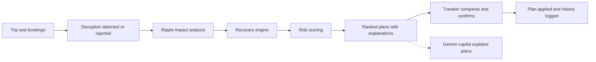

# ReMode: Travel Disruption Recovery Engine

When a flight is delayed or a train is cancelled, airlines and railways only manage their own leg of the journey. Nobody works out what it means for the connecting transfer, the hotel check-in or the rest of the trip. ReMode treats a traveler's whole itinerary as one connected graph, detects disruptions, calculates the downstream impact, and proposes ranked, explainable recovery plans that the traveler confirms before anything changes.


---

## Table of Contents

- [Key Features](#key-features)
- [How It Works](#how-it-works)
- [Tech Stack](#tech-stack)
- [Getting Started](#getting-started)
- [Environment Variables](#environment-variables)
- [Running Tests](#running-tests)
- [Project Structure](#project-structure)
- [Dataset](#dataset)
- [Limitations and Roadmap](#limitations-and-roadmap)


---

## Key Features

- **Trip graph and ripple impact:** every booking (flight, train, cab, hotel) records what it depends on, so one delay shows exactly which transfers and check-ins are at risk.
- **Deterministic recovery engine:** ranks multimodal alternatives on cost, time, cancellation policy, safe buffer thresholds and weather risk, so plans are repeatable and testable.
- **Explainable plans:** each plan carries risk, convenience and trip-preservation scores plus a plain-language explanation.
- **Side-by-side comparison and safe apply:** compare plans, then confirm before any change is applied. Every change is recorded in trip history.
- **AI travel copilot:** a Gemini-powered assistant that explains a plan and answers questions. It narrates the engine's output and never generates the plan itself.
- **Digital-twin weather simulator:** adjust rainfall, wind, temperature and visibility to see the effect on flight, train and road delays and missed connections.
- **Domain-aligned model evaluation:** a Nugen-aligned model evaluates weather impact, with a rule-based fallback grounded in the same domain rules.
- **Live data integrations:** weather, flight and train status, maps and routing, emergency hotels, and news signals, with alerts over Twilio WhatsApp and SMS.
- **Interactive maps:** Leaflet route maps with weather radar, emergency-hotel layers and a live cab tracker.

---

## How It Works



The recovery plan is computed by deterministic code (`RecoveryEngine.ts` and `RiskScorer.ts`). The language model only explains a plan that already exists. This keeps the core auditable and prevents a hallucinated plan during a real disruption.

---

## Tech Stack

| Layer | Technologies |
|---|---|
| Frontend | Next.js 14 (App Router), React 18, TypeScript, Tailwind CSS, Motion, GSAP |
| Maps | Leaflet, React-Leaflet, Ola Maps |
| Backend | Next.js API routes (31 endpoints), Node.js |
| Database | PostgreSQL with Prisma ORM |
| AI | Google Gemini (`@google/genai`), Nugen-aligned domain model |
| Integrations | OpenWeather, AeroDataBox, IRCTC train data, Twilio |
| Testing | Node.js built-in test runner |

---

## Getting Started

### Prerequisites

- Node.js 20 or newer
- PostgreSQL database

### Installation

```bash
git clone https://github.com/<your-username>/remode.git
cd remode
npm install
```

### Configure environment

```bash
cp .env.example .env
```

Set `DATABASE_URL` to your PostgreSQL connection string. The other keys are optional (see [Environment Variables](#environment-variables)). Without them, the app uses mock providers and rule-based fallbacks where available.

### Set up the database

```bash
npx prisma db push
npx prisma db seed
```

### Run the app

```bash
npm run dev
```

Open `http://localhost:3000`.

---

## Environment Variables

| Variable | Required | Purpose |
|---|---|---|
| `DATABASE_URL` | Yes | PostgreSQL connection string |
| `GEMINI_API_KEY` | No | Copilot explanations and analysis |
| `NUGEN_API_KEY`, `NUGEN_MODEL_ID` | No | Nugen-aligned weather-impact model |
| `OPENWEATHER_KEY`, `NEXT_PUBLIC_OPENWEATHER_KEY` | No | Live weather data |
| `AERODATABOX_KEY` | No | Live flight status |
| `IRCTC1_KEY` | No | Live train status |
| `OLA_MAPS_API_KEY`, `NEXT_PUBLIC_OLA_MAPS_API_KEY` | No | Routing and directions (defaults to a mock provider if unset) |
| `TWILIO_*`, `WHAPI_TOKEN` | No | WhatsApp and SMS alerts |
| `APP_URL`, `INTERNAL_API_SECRET` | No | Internal polling endpoints |

> Never commit real keys. Keep `.env` and `.env.local` out of version control.

---

## Running Tests

```bash
npm test
```

The suites cover the recovery engine, ground transport providers, weather and digital-twin simulation, the Nugen service, live cab tracking and emergency-hotel lookup.

Background polling scripts for live disruptions:

```bash
npm run poll:flights
npm run poll:trains
```

---

## Project Structure

```
remode/
├── src/
│   ├── app/                 # Pages (landing, login, signup, dashboard, trip/new) and API routes
│   ├── components/          # Dashboard views, maps, copilot drawer, simulators
│   ├── core/
│   │   ├── RecoveryEngine.ts    # Multimodal recovery planning
│   │   ├── RiskScorer.ts        # Buffer, exposure and arrival-risk scoring
│   │   ├── ExplanationEngine.ts # Plan explanations
│   │   ├── geminiAgent.ts       # Copilot and narration
│   │   ├── providers/           # Ground transport providers (real and mock)
│   │   └── dataset/             # Route catalogs and benchmark data
│   ├── lib/                 # Trip service, weather, notifications, Nugen service
│   └── context/             # Auth context
├── prisma/                  # Schema and seed
├── data/                    # Recovery dataset (CSV)
├── docs/                    # PRD and alignment architecture
├── scripts/                 # Disruption polling and dataset tooling
└── tests/                   # Automated test suites
```

---

## Dataset

The `data/` folder holds the recovery dataset used by the engine:

- `travel_recovery_master_dataset.csv`: 15,215 resource records
- `travel_disruption_scenarios.csv`: 12 benchmark scenarios
- `dataset_data_dictionary.csv`: column definitions and provenance

Dataset endpoints: `GET /api/dataset/summary`, `/scenarios`, `/dictionary` and `/resources`.

---

## Limitations and Roadmap

- Sign-in is a lightweight, email-based profile for demonstration and is not production authentication.
- Live train data depends on third-party APIs.
- Booking changes are simulated and human-confirmed, with no real provider rebooking.
- Planned: real authentication, background job workers for live polling, provider integrations for actual rebooking, personalization and proactive alerts.

---
